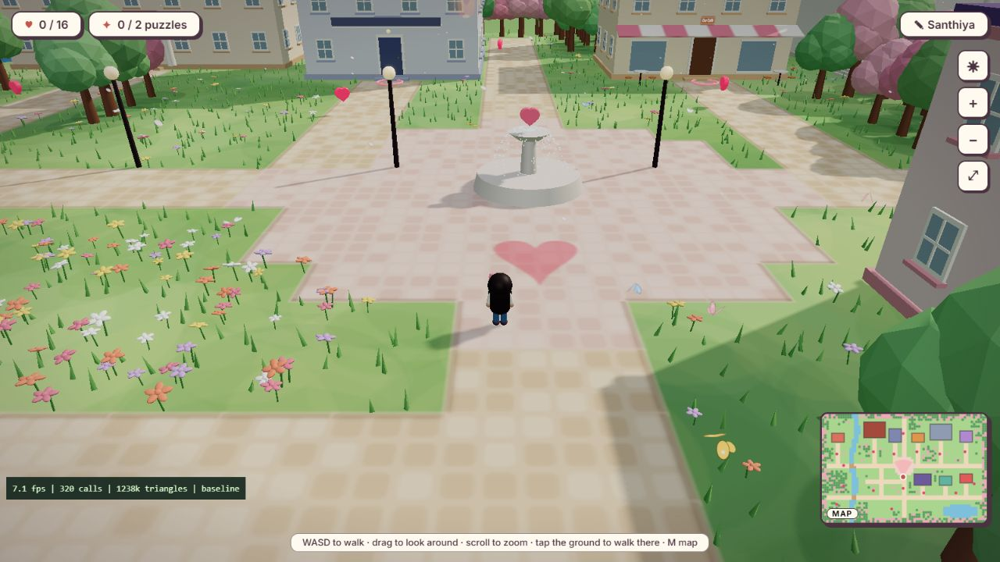
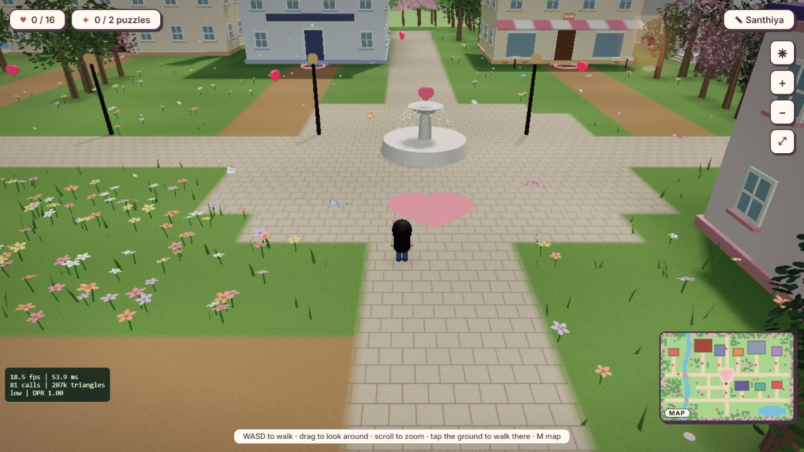
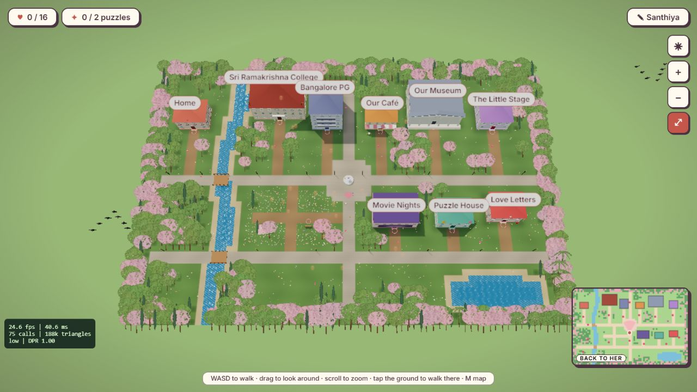
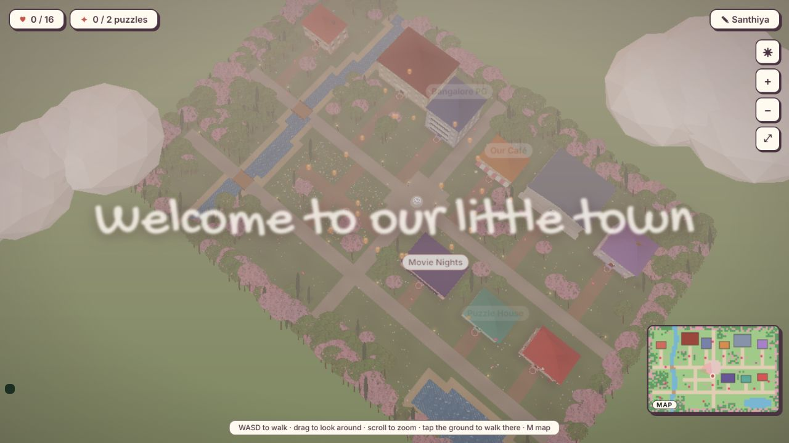
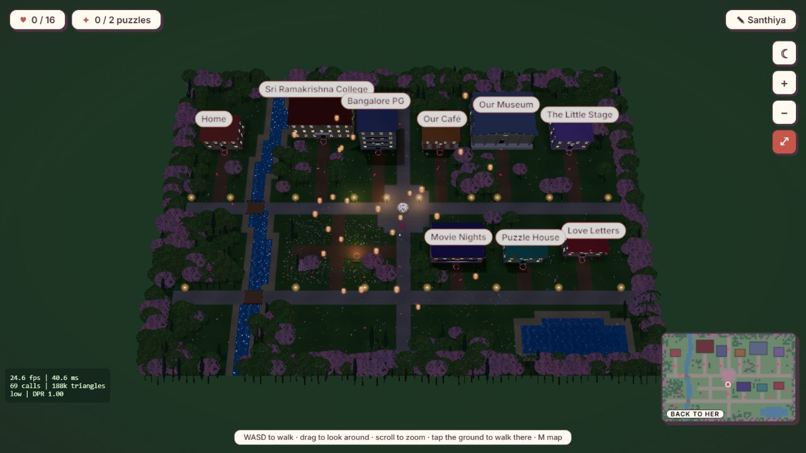
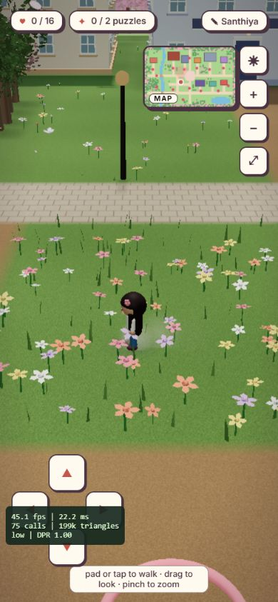
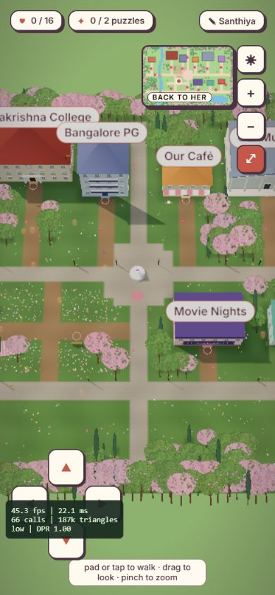

# Town rendering upgrade

This branch replaces the faceted tree crowns and painted terrain with four leaf-card tree species and blended PBR ground, and reduces the existing scene's submission cost. It remains a **draft** until the frame-rate acceptance gate is met.

## Implementation

- Cherry blossom, oak, cypress and palm trees share an alpha-tested leaf/bark texture. Each species has full, simplified and camera-facing billboard instances, with colour/scale/rotation variation. Eight-tile vegetation chunks and per-tree bounds compact the visible instances into 12 shared batches. Only near trees cast shadows; leaves sway more than wood, including in the depth pass.
- Grass, dirt, paving and sand use generated albedo plus normal/roughness texture arrays. Layout-derived splat and coverage maps blend the layers and expose the water. Arrays prevent mip bleeding between materials; unused layers skip their texture reads. Detail layers are 256px on mobile, 512px on desktop; no external assets or texture downloads. Large-scale tint and baked tree/building AO reduce repetition.
- Inaccessible forest tiles have small mounds. Roads, building footprints and all walkable grass remain flat. A reusable local grass field follows the avatar, with density tiers and a shrinking edge, and disappears in map view.
- Water keeps the existing scrolling normal map, with inexpensive Fresnel tint and shoreline foam. Height haze uses the existing day/night fog palette. The plaza heart inlay, lamps, labels and collectible hearts remain.
- Architecture shares vertex-colour material buckets. Animated birds, clouds, butterflies, hearts and door rings use shared instance batches; halos and lanterns use billboard batches. Flower petals replace the old sphere geometry. Fixed head details are merged while blinking and walking pivots remain separate.
- Low/medium/high quality samples frame intervals in two-second windows, demotes above 20ms or the draw/triangle budgets, and waits twelve healthy seconds before promotion. Mobile starts at medium. Pixel ratio, grass, LOD, shadow size and bloom respond to the tier. Bloom is half resolution and disabled on low. The one shadow light follows the player with a 60m frustum; the point-light pool is capped at four. Low uses contact blobs instead of avatar shadow draws; far map avatars use small proxy meshes.
- Rendering pauses while the document is hidden. Temporary vectors, light-order buffers and the partner trail are reused. Unmount disposes shader textures, depth materials, instance buffers, shadows, postprocessing passes, environment targets and input listeners.
- The town stays dynamically imported. Loading preloads its chunk and reports progress before entering the scene. The final town chunk is approximately 657KB / 179KB gzip, including Three.js; the build retains Vite's 500KB chunk advisory.

## Reproduce

```sh
cd frontend
npm run build
node --test tests/town-rendering.test.mjs
npm run preview -- --host 127.0.0.1
```

Open `/?town&fps`. The overlay includes shadow and postprocessing draws because renderer statistics reset once per complete frame. Its frame rate is the average over two seconds, after a four-second warmup; it is not a worst-frame guarantee. `&time=day`, `&time=sunset` and `&time=night` set a reproducible starting phase only when `fps` is present, then the normal cycle continues.

For the mobile proxy, use 390x844, touch/coarse pointer and 4x CPU throttle. Reload after configuring the device so its initial tier and texture dimensions are selected correctly. Walk, use tap routing, toggle M/map and day/night, and test the partner and birthday show separately. Do not run a second town renderer alongside the measured page.

## Validation and remaining gate

`npm run build`, `node --test tests/town-rendering.test.mjs` (2 tests), and `git diff --check` pass. Tests exercise demotion, promotion hysteresis, visibility-reset warmup, normalized splat weights, mobile texture caps, flat walkable surfaces and bridge routing. Browser checks exercised walking, tap routing from the map, map transitions, day/night, tree LOD views, shader compilation and avatar-editor unmount/re-entry without production console errors.

The requested sustained 55-60fps and never-below-45fps requirement has **not passed** in this environment. No physical iPhone 13/Safari run was available. The measurements below are embedded Chromium point samples, not a certified device result. The baseline was an isolated copy of `d54916c`, instrumented only to count complete-frame draws and FPS. Its comparison screenshot uses the same spawn camera; original fixed DPR differs from the adaptive branch. Full museum/puzzle/gift/partner/birthday interaction regression remains to be run before marking this PR ready.

| Run | FPS sample | Draw calls | Triangles | Settings |
| --- | ---: | ---: | ---: | --- |
| Baseline, spawn | 7.1 | 320 | ~1,238k | 1280x720, 1x CPU, fixed DPR 1.25 |
| Final desktop, spawn | 18.5 | 81 | 206,643 | 1280x720, 1x CPU, low / DPR 1 |
| Final desktop, map | 24.6 | 75 | 187,841 | 1280x720, 1x CPU, low / DPR 1 |
| Final mobile, walking | 45.1 | 75 | ~199k | 390x844, 4x CPU, low / DPR 1 |
| Final mobile, map | 45.3 | 66 | 186,691 | 390x844, 4x CPU, low / DPR 1 |

See `measurements.json` for settings and limitations. The baseline/new FPS rows differ in DPR; the mobile/desktop rows differ in resolution and CPU throttle, so they are not interchangeable speed comparisons.

## Screenshots

Before (original terrain and faceted crowns):



After, walking:



After, full map:



After, sunset:



After, night:



Mobile CPU-throttle proxy:




